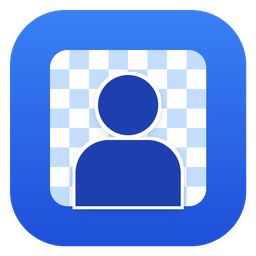

<p align="center"></p>

# Nuggi

[English](README.md) | **한국어**

`Nuggi`는 이미지 배경을 제거(누끼)하는 Windows 앱입니다. 이미지를 추가하고, 실시간 미리보기로 인식된 피사체를 확인하고, 필요하면 영역을 직접 고친 뒤 투명 PNG로 한 번에 저장합니다.

작성자: **Manggdy**

## 기능

- 이미지 파일을 하나씩 추가하거나, 폴더 안의 지원 이미지를 하위 폴더까지 한꺼번에 추가
- 나란히 보는 미리보기: 원본 이미지와 인식된 피사체 영역
- 마스크 편집기: 브러시로 영역 추가/지우기, 브러시 크기, 확대/축소, 실행 취소(`Ctrl+Z`), 영역 전체 삭제, 자동 마스크로 되돌리기
- 마스크 편집기의 **객체 클릭**: 객체를 클릭해 그 객체만 추가하거나 지우기 (Segment Anything)
- `마스크 저장`: 선택한 이미지의 마스크를 흑백 PNG로 저장 (흰색 = 남길 영역, 직접 편집한 내용 포함)
- 투명 PNG 일괄 저장. 한 이미지가 실패해도 나머지는 계속 진행되며, 실패 이유는 로그에 표시
- 피사체 주변의 빈 투명 여백 자르기(선택)
- 첫 마스크가 이미지 거의 전체이거나 거의 비어 있으면, 이미 내려받은 다른 모델로 자동 재시도
- 창을 닫으면 실행 중인 백그라운드 작업도 중지

## 기술 스택

- UI: C# WinForms (.NET 8)
- 배경 제거 엔진: Python `rembg` (Pillow, onnxruntime)
- 객체 선택: Segment Anything ViT-B 양자화 모델 (`sam_vit_b_01ec64`, Apache-2.0)
- 출력: 투명 PNG

## 실행

`run.bat`을 실행합니다. 이 스크립트는 다음을 수행합니다.

1. 필요하면 Python 가상환경(`.venv`) 생성
2. 필요하면 Python 의존성 설치
3. WinForms 앱 빌드
4. `Nuggi.exe` 실행

앱이 Python을 찾을 수 없다고 하면 `.venv`가 더 이상 없는 Python 설치를 가리키는 것입니다. `.venv` 폴더를 지우고 `run.bat`을 다시 실행하세요.

## 처음 실행할 때

처음 배경 제거를 실행하면 분할 모델을 자동으로 내려받습니다(`u2net` 약 170 MB). 객체 클릭은 처음 쓸 때 Segment Anything을 내려받습니다(약 113 MB). 배포 패키지에는 둘 다 들어 있습니다.

자동 마스크 재시도는 이미 내려받은 대체 모델(`.u2net` 또는 `%USERPROFILE%\.u2net`)만 사용하므로, 일괄 처리 도중 큰 다운로드가 시작되지 않습니다.

## 사용법

1. `파일 추가` 또는 `폴더 추가` 클릭
2. 목록에서 이미지 선택
3. 오른쪽 미리보기 확인: 초록색이 남길 영역
4. 선택: `영역 편집`으로 영역을 고친 뒤 `편집 적용`
   - `브러시`: 마우스로 칠하기
   - `객체 클릭`: 객체 클릭 — `영역 추가`면 추가, `영역 지우기`면 제거
   - 객체 하나만 남기려면: `영역 전체 삭제` 후 `객체 클릭` + `영역 추가`로 그 객체를 클릭
5. 저장 폴더, 모델, 여백 자르기 옵션 선택
6. `누끼 추출 시작` 클릭

마스크만 필요하면 이미지를 선택하고 `마스크 저장`을 클릭합니다.

직접 편집한 마스크는 앱을 닫을 때까지 유지됩니다.

## 지원 형식

- `.png`
- `.jpg`, `.jpeg`
- `.bmp`
- `.webp`
- `.tif`, `.tiff`

## 출력 파일 이름

- `photo.jpg` -> `photo_nuggi.png`
- 같은 이름이 이미 있거나 입력 파일 이름이 겹치면 `photo_nuggi_1.png`, `photo_nuggi_2.png` 순으로 저장
- 마스크: `photo.jpg` -> `photo_mask.png` (원본과 같은 크기, 이미 있으면 `photo_mask_1.png`, …)

## 임시 파일

마스크와 미리보기 사본은 `%TEMP%\Nuggi`에 캐시됩니다. 30일이 지난 파일은 앱 시작 시 삭제됩니다.

## 테스트

```bat
.venv\Scripts\python.exe -m unittest discover -s tests
```

## 포터블 배포

`publish.bat`을 실행하면 `publish/Nuggi-win-x64`와 zip 압축 파일이 만들어집니다.

패키지에는 배경 제거 엔진에 필요한 모든 것이 들어 있습니다: 모든 패키지가 설치된 포터블 Python 런타임(`python/`)과 `%USERPROFILE%\.u2net`에서 가져온 모델(`.u2net/`). 대상 PC에 Python이 없어도 됩니다.

앱 크기를 줄이기 위해 앱 자체는 프레임워크 종속 방식이므로, 대상 PC에 Microsoft .NET 8 Desktop Runtime (x64)이 설치되어 있어야 합니다. 압축을 풀고 `Nuggi.exe`(또는 `Launch Nuggi.bat`)를 실행하세요. 배포 패키지에는 `.pdb` 디버그 심볼 파일이 포함되지 않습니다.

## 주요 파일

- `MainForm.cs`: 메인 창 (파일 목록, 설정, 미리보기, 일괄 실행)
- `MaskEditorForm.cs`, `Controls/MaskCanvasControl.cs`: 마스크 편집기
- `Theme.cs`: 공통 색상, 글꼴, 컨트롤 스타일
- `Assets/icon.ico`: 앱 아이콘 (`Assets/icon.png`: README용)
- `Services/NuggiPythonBridge.cs`: Python 워커 실행
- `scripts/nuggi_worker.py`: 워커 명령 (`mask`, `select`, `convert`, `batch`)
- `nuggi/background_remover.py`: 마스크 생성과 품질 검사
- `tests/test_worker.py`: Python 테스트
- `run.bat`, `publish.bat`
